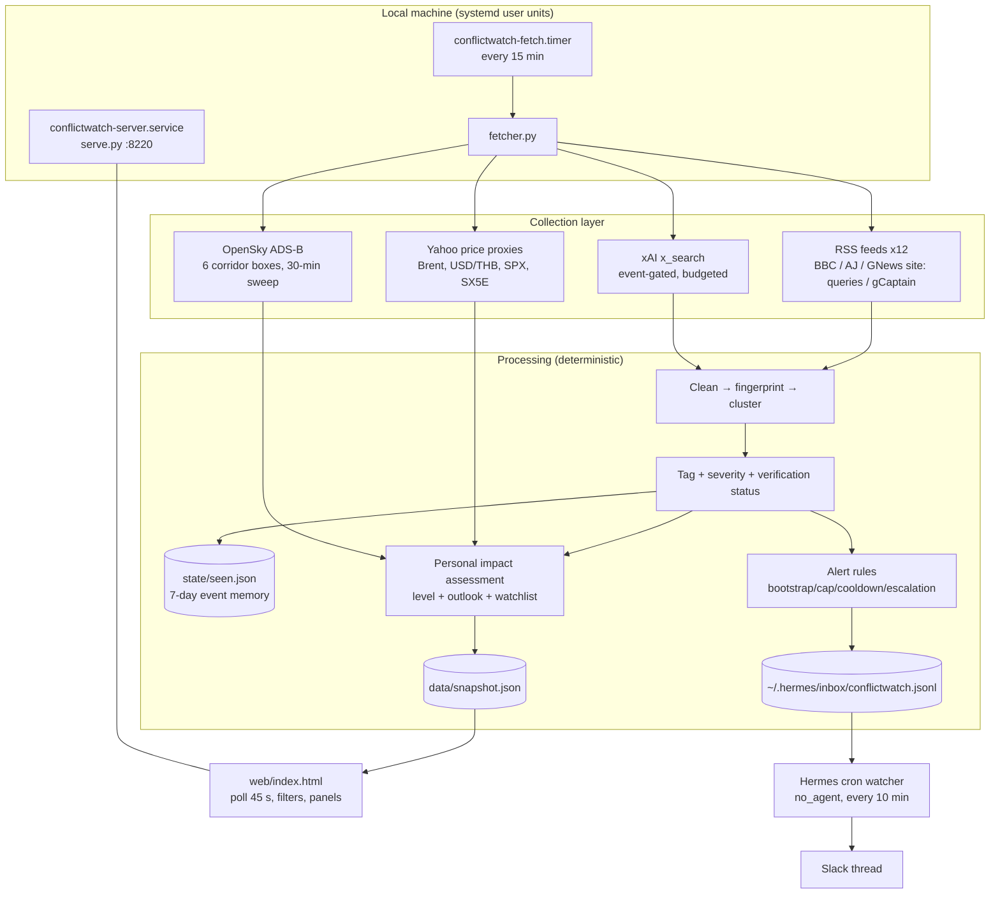
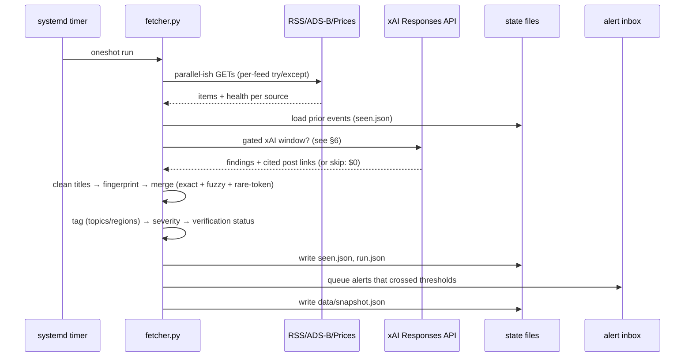
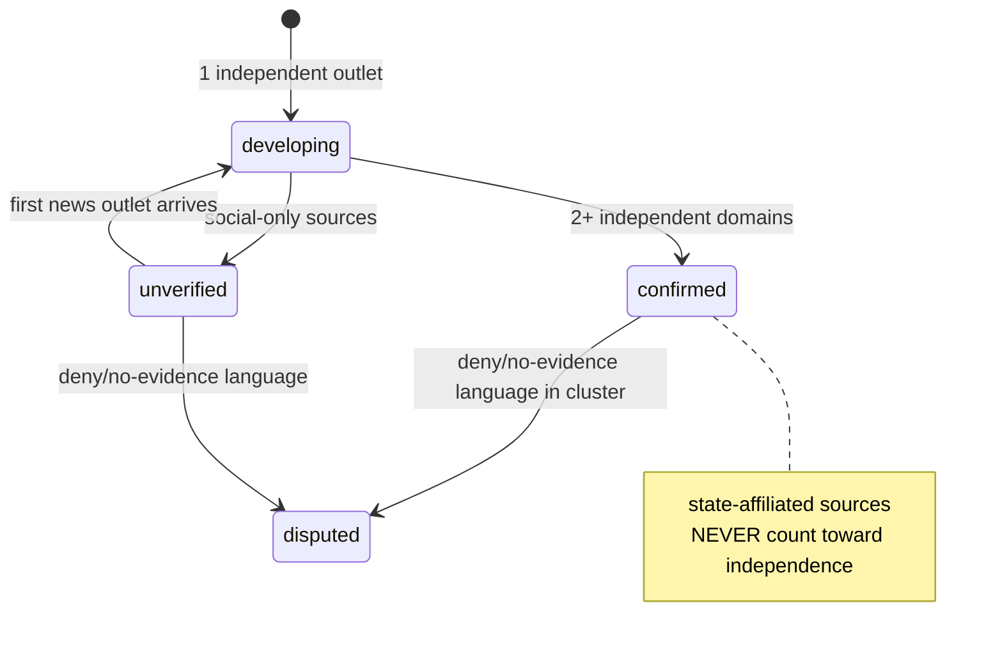
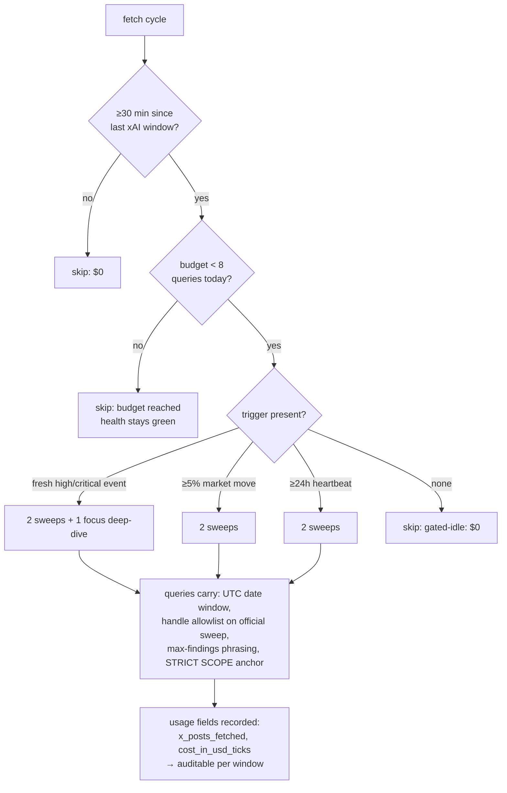
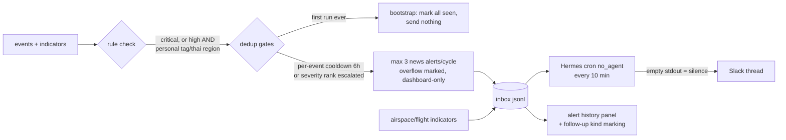

# ConflictWatch — Architecture & Operating Reference

This document is the deep-dive reference: how data flows, how decisions are made, and why
each design choice exists. For quick day-to-day commands see `README.md`.

---

## 1. What the system is

ConflictWatch is a **personal, local monitoring board** that watches the Iran/Middle-East
conflict and translates it into "does this affect me in Bangkok in the next 24 hours".
It is deliberately built from four planes that never blend into each other:

| Plane | Content | Examples |
|---|---|---|
| Independent reporting | outlets with editorial responsibility | BBC, Al Jazeera, CNN, Reuters, CNA |
| State-affiliated reporting | government-owned media (kept, labeled, never used for corroboration) | CGTN, Xinhua |
| Official claims | statements by involved parties | ministry/military handles, IRGC statements |
| Analysis & social discovery | commentary, eyewitnesses, unverified chatter | X posts via xAI x_search, gCaptain industry posts |

Everything the system ingests — headlines, post text, API payloads — is **untrusted data**.
The fetcher is deterministic Python: no model ever executes fetched content, and the web UI
renders every fetched string via `textContent` (never HTML), so a malicious headline can
only ever be *displayed as text*.

## 2. System overview



State lives in three files only, all written **atomically** (tmp + `os.replace`):
`state/seen.json` (event clusters, 7-day horizon), `state/run.json` (budgets, baselines,
alert bookkeeping, price/airspace series), `data/snapshot.json` (everything the UI shows).

## 3. The fetch cycle (every 15 minutes)



Every source records health (`ok`, failure count, last success) into the snapshot.
The dashboard shows outages in a red banner and an all-failing collector can itself be
treated as an information problem — silence never looks like success here.

## 4. Deduplication & clustering (how "one event" is defined)

News clustering is the hardest honest part of the system; the pipeline is deliberately simple:

1. **`clean_title()`** — strips trailing newsroom suffixes (`- Reuters`, `| CBN NewsWatch`,
   …) and normalizes quotes. Without this, one story gets N fingerprints.
2. **Exact fingerprint** — stopwords removed, sorted token set hashed.
3. **Fuzzy merge** — Jaccard overlap vs the cluster's **base-title tokens (`tok0`)**.
   Rule: `shared ≥ 4 tokens AND overlap ≥ 0.42`, OR `one rare conflict token shared
   (hormuz, qeshm, natanz, …) AND shared ≥ 3 AND overlap ≥ 0.30`.
4. **Why base tokens, not accumulated** — merged headlines grow the union forever; scoring
   against accumulated tokens makes an old cluster permanently un-mergeable and spawns
   duplicate events (this was an observed, fixed failure mode).

Consequence, stated honestly: near-duplicates with radically different wording can still
form separate clusters. The dedup is strong enough to make *independence counting* correct
(§5), which is what actually matters for verification.

## 5. Verification & severity state machine



Two special guards:

- **Extraordinary-claim guard** — any cluster mentioning nuclear/radiological/IAEA/enrichment
  terms is forced to `unverified` until **2+ independent outlets** corroborate. Nuclear
 *threats*, *facility incidents*, *radiological release*, and *detonation* are different words
  and the guard prevents the first from being rendered like the last.
- **Independence domain extraction** — Google News RSS links all resolve to
  `news.google.com`; the item's `<source>` outlet tag is used as the domain key instead,
  otherwise every "independent outlet" collapses to one fake domain and corroboration
  becomes fiction.

Severity is keyword-heuristic (`critical_terms` → critical, `high_terms` → high, tagged
infrastructure topics → moderate) with a sparse-route guard upstream. It is a triage aid,
not a claim about the world; thresholds are editable in `config.json`.

## 6. Cost architecture of the X layer (the interesting part)

Billing reality (verified against the API and console logs): xAI charges **per fetched
post** ($5/1,000; parent/quoted posts count) **plus model tokens** — not per query. And the
date/handle constraints you send inside the tool object are **advisory to Grok's internal
planner**: they arrive and are recorded, but the model may still widen internal searches;
A/B measurement showed fetch volume variance dominates. So cost is controlled structurally:



Design intent: quiet days ≈ **$0.14–0.30** (one heartbeat window), hard ceiling **8
queries/day ≈ $1.10**, and event windows get budget priority over routine pulses.
A focus query's *negative* findings are valuable output, not waste — the first real one
returned "no independent eyewitness accounts exist; reporting traces to official sourcing",
which is a verification signal no RSS feed provides.

## 7. Airspace pulse (Layer A)

Empirical airspace-closure detector using free keyless OpenSky ADS-B:

- 6 boxes: Tehran, Iraq–Levant, Gulf/Hormuz, Red Sea–Yemen, Thai↔Europe corridor,
  Thailand reference (control).
- Aircraft-count sample per 30-min sweep; baseline = median of **same time-of-day**
  samples over the last 3 days (±90 min window) — traffic has strong day/night cycles.
- `states: null` responses are recorded as **data gaps, never as zero traffic** (a null-as-zero
  bug would fabricate permanent collapse); boxes with baseline <5 aircraft never ratio-alert
  (sparse-route guard); WARMING state blocks judgment until ≥4 samples exist (~1–2 days).
- Collapse (two consecutive samples ≤50% of baseline) raises an **indicator-class** Slack
  alert that says out loud it is not a confirmed NOTAM.

## 8. My flights (Layer B)

Itinerary lookups via AeroDataBox (free RapidAPI tier, ~500 calls/month):
`config.flights.list` entries `{flight, date}` are checked on a 6-hour throttle; the API key
lives only in `~/.conflictwatch/rapidapi_key` (mode 600, never in repo/env/browser). Until a
key exists the dashboard prints the exact registration steps instead of any placeholder
data — idle-but-honest over silently broken. Cancelled/Diverted statuses alert once per
flight-day, with a "verify with your airline" line.

## 9. Alert pipeline



Alert bodies always carry: what/where, verification status with corroboration note ("2+
independent outlets: aljazeera.com, cnn, reuters" or "single source so far"), why it maps
to a personal concern, first-seen age, source links, and the dashboard URL. Social-only
clusters cannot alert below critical. Indicators (airspace, flight status) use their own
id-space (`pulse:<box>`, `flight:<num>:<date>`) so they never collide with news dedup.

## 10. Personal impact assessment

The top block ("What matters to me now") is a *rule table over live state*, not a model
opinion — traceable and auditable:

```
Critical : ≥1 critical event confirmed/developing touching concern tags
High     : ≥1 high event touching concern tags (flights/fuel/electricity/internet/shipping/TH)
Unclear  : ≥4 sources failing (coverage problem)
Moderate : high events exist, no direct concern mapping
Low      : nothing credibly confirmed affecting Bangkok in next 24h
```

Outlooks are qualitative baseline/escalation scenario text with mechanisms spelled out
(Hormuz → freight/insurance → Thai pump prices with 1–2 week lag; airspace → Europe-route
detours), no invented probabilities. Current observed impacts vs possible future impacts
are kept in separate panels (pulse/prices = observed; outlook = possible).

## 11. Dashboard

One static page, zero build step, zero external assets: vanilla JS polls
`/data/snapshot.json?ts=` every 45 s (server replies `no-store`; query string stripped
before path resolution). All rendering via `textContent`. Filters (severity/status/topic/
location/source-type) are client-side over the snapshot. Time is displayed in
`Asia/Bangkok` via `Intl.DateTimeFormat` while everything stored is epoch UTC. Stale data
(age > configurable) repaints the title bar with a warning — a dead collector can never
present yesterday as today.

## 12. Threat model & assumptions

- Fetched content is untrusted input; deterministic pipeline + text-only rendering = the
  injection surface is *display only*.
- Secrets: `XAI_API_KEY` read at runtime from a 600-perm env file by path; RapidAPI key
  likewise; **no credentials in repo, snapshot, HTML, or logs**. Notification delivery uses
  the local agent gateway's cron plumbing — no webhook secrets on disk here.
- Trust boundaries of the *content*: "confirmed" means multiple independent newsroom domains
  agreed — not that a claim is true. State-affiliated and official-claim labels exist so the
  human reader applies political skepticism, which no pipeline can automate.
- Availability: monitoring depends on this machine being on. Offline host ⇒ no collection,
  no alerts, stale-by-design dashboard.

## 13. Limitations ledger (no sugar)

- Clustering under-merges radically reworded duplicates; over-merging is rarer but possible.
- NOTAM text has no reliable free API — legal closure notices are detected via their effects
  (ADS-B emptiness) or news echoes, not by ingestion.
- x_search handles are advisory; focus windows occasionally fetch 30+ posts (the observed max).
- No missile-trajectory or radar ingestion; kinetic-event claims rely entirely on reporting.
- Thai fuel/electricity pass-through is described by mechanism, not modeled numerically.
- Tick-scale of xAI's `cost_in_usd_ticks` is undocumented; spend should be watched on the
  console's own usage page (the system's per-window numbers are derived estimates).

## 14. Tuning map (what changes what)

| Want | Change |
|---|---|
| Cheaper X layer | `xai.max_calls_per_day` ↓, `heartbeat_hours` ↑, handles on more queries |
| Faster alerting | `fetch.interval_minutes` (timer) ↓, `alert.min_severity_personal` |
| Quieter alerts | `alert.cooldown_hours` ↑, trim `alert.personal_tags` |
| More/less airspace boxes | `airspace.boxes` (id/min/max/personal) |
| Different city/person | `keywords.thailand` terms, `regions.southeast asia`, `alert.personal_tags`, `dashboard.timezone` |
| Sources | `sources[]` (name/url/bias) — bias field is security-relevant for corroboration |
